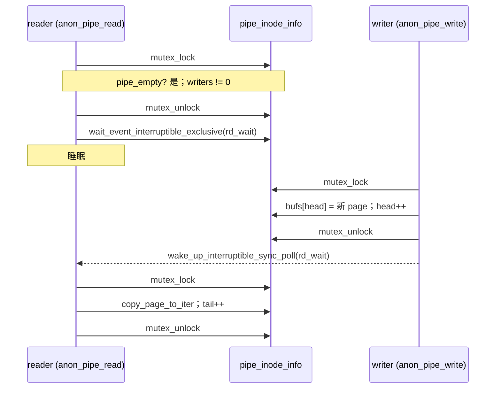
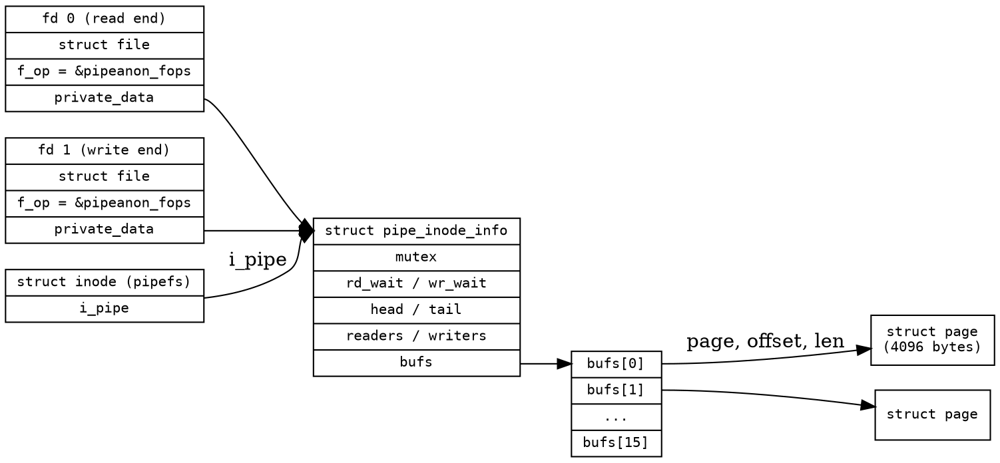

# Ch 7 — 讀碼筆記與畫圖：把理解外部化

> **目標**：建立一套之後整門課都會用的讀碼筆記格式（問題、假說、證據、結論、未解疑問），學會用縮排 call tree、ASCII 資料結構圖、時序圖、狀態圖把理解畫出來，會在 scratch 分支上加 `NOTE:` 註解，並且跟著做完一份 `fs/pipe.c` 讀取路徑的完整筆記。
> **鴻溝**：本章主要練**目標鴻溝**——筆記的第一欄就是問題，它逼你每次讀碼都帶著問題；call tree 的記號則讓你把**間接鴻溝**的斷點明確標出來，而不是假裝追通了。

> **環境**：Linux kernel v6.18（`~/code_reading/linux`）；WSL Ubuntu 22.04，執行中的 kernel `6.18.58.1-microsoft-standard-WSL2`；graphviz 2.42（Ubuntu 22.04 的 `.deb` 用 `apt-get download` 下載後 `dpkg -x` 解到 `~/.local/graphviz`，不需要 root；`dot -V` 回報 `2.43.0`）；git 2.34。

## 為什麼需要這個？

你一定有過這種經驗：花了一個下午追懂一段程式碼，三天後回來，只記得「我好像懂過」，細節全忘了，只好重追一次。

這不是記性差，是工作記憶的物理限制。kernel coding style 第 6 節談函式長度時順口提到一個數字：人腦大概同時追得住 7 件事左右（`Documentation/process/coding-style.rst`）。讀一個 kernel 函式時，你腦子裡同時要放：這個變數現在是什麼、這把鎖拿了沒、這個指標可能是 `ERR_PTR` 嗎、上一層是誰呼叫進來的、ops 表指向誰……輕易就超過 7 件。超過的部分不寫下來，就會掉。

讀碼筆記做三件事：

1. **卸載工作記憶**：寫下來的東西不用記，腦子空出來處理眼前這一行。
2. **讓理解可以被檢查**：「我懂了」是一種感覺；「`anon_pipe_read` 在 `fs/pipe.c:370` 檢查 `!pipe->writers` 後回傳 0」是一個可以被驗證或推翻的命題。
3. **讓三天後的你接得上**：筆記是寫給未來的自己的交接文件。

研究上也有對應的觀察：LaToza、Venolia、DeLine 2006 年在 Microsoft 的調查發現，開發者普遍抱怨「重建對程式碼的理解」花掉大量時間，而且這些理解很少被寫下來；Ko 等人的觀察研究也看到開發者反覆重新導航到之前看過的程式碼（兩篇都在延伸閱讀）。筆記就是對這個問題最直接的回應。

## 先建立直覺

把讀碼筆記想成**實驗紀錄簿**，不是讀書心得。

讀書心得記的是「我學到什麼」；實驗紀錄簿記的是「我想驗證什麼、我預測什麼、我看到什麼、所以結論是什麼、還有什麼沒搞清楚」。差別在於後者**連錯誤的預測也要記**，因為「我原本以為 X，結果是 Y」正是你學到東西的地方（[Ch 3](./03-question-driven-reading.md) 的假說驗證迴圈）。

```
         ┌─────────┐
         │  問題    │  我想知道什麼？（一句話，可以被回答）
         └────┬────┘
              ▼
         ┌─────────┐
         │  假說    │  我猜答案是什麼？（讀碼之前就寫）
         └────┬────┘
              ▼
         ┌─────────┐
         │  證據    │  file:line（版本）+ 必要的幾行原文 + 實驗輸出
         └────┬────┘
              ▼
         ┌─────────┐
         │  結論    │  假說成立／推翻／修正，附信心
         └────┬────┘
              ▼
         ┌─────────┐
         │ 未解疑問 │  讀的過程中冒出來、這次不追的問題
         └─────────┘ ──→ 變成下一輪的「問題」
```

## 筆記格式：五欄

本課從現在開始一律用這個格式。它就是一份 markdown：

```markdown
# <主題>：<一句話>

- 版本：Linux v6.18（或其他專案的 tag / commit）
- 日期：YYYY-MM-DD
- 起點：<從哪裡進來的，例如 strace 看到的 syscall>

## 問題
- Q1：...
- Q2：...

## 假說（讀碼前寫，讀完後標狀態）
- H1：...　→ 成立 / 推翻 / 修正為 ...
- H2：...

## Call tree
（縮排寫法，見下一節）

## 證據
- E1（回答 Q1）：`fs/pipe.c:370-371`（v6.18）
  ```c
  if (!pipe->writers)
      break;
  ```
  說明：...
- E2：實驗輸出 ...

## 結論
- Q1：...（信心：高，有程式碼 + 實驗）
- Q2：...（信心：中，只有程式碼）

## 未解疑問
- [ ] ...
- [ ] ...
```

每一欄的規則：

| 欄位 | 規則 | 常見錯誤 |
|---|---|---|
| 問題 | 一句話、可以被回答、讀完能判斷有沒有回答到 | 「搞懂 pipe」——太大，永遠回答不完 |
| 假說 | **讀碼之前**寫；讀完不要刪，標成立／推翻 | 讀完才寫假說，變成事後諸葛 |
| 證據 | `file:line（版本）`，必要時貼 2–10 行原文；實驗附指令和真實輸出 | 只寫「在 pipe.c 裡」——三天後找不到；不寫版本——行號會漂移 |
| 結論 | 回答對應的問題，標信心與信心來源 | 結論沒有對應任何問題，變成流水帳 |
| 未解疑問 | 用 checkbox，之後回答了就勾掉並寫答案在哪 | 不寫，讓它停留在模糊的不安 |

**版本一定要寫**。行號是會漂移的：[Ch 4](./04-selective-reading.md) 看過，`do_renameat2()` 的 EEXIST 檢查在 v6.14 是 `fs/namei.c:5181`，在 v6.18 已經搬進另一個函式。沒有版本的行號，三個月後就是錯的。

## 粒度：寫到什麼程度

最難拿捏的是粒度。太粗，三天後看不懂；太細，你在抄程式碼。判斷標準只有一條：

> **未來的你，能不能只看筆記和它引用的行號，在五分鐘內重新驗證每一條結論？**

對照兩個極端：

```
太粗：
  - anon_pipe_read 會讀資料，沒資料就等。

太細：
  - 271 行宣告 total_len 為 iov_iter_count(to)
  - 272 行宣告 filp 為 iocb->ki_filp
  - 273 行宣告 pipe 為 filp->private_data
  - 274 行宣告 wake_writer 和 wake_next_reader 為 false
  ...（一路抄到 404 行）

剛好：
  - 主迴圈 fs/pipe.c:292-393（v6.18）：有資料就複製（321-368），沒資料時依序檢查
    writers==0 → 回 0（370）、已讀到東西 → 回已讀量（372）、
    O_NONBLOCK → -EAGAIN（374-378），都不是才放鎖去睡（379-392）。
```

「剛好」那一條有三個特徵：**有行號範圍**、**講的是決策而不是語句**、**順序和程式碼的檢查順序一致**（順序本身就是資訊：先檢查 writers 再檢查 ret，代表「沒有寫端且沒讀到東西」回 0 而不是 EAGAIN）。

幾條經驗法則：

- **一個函式在 call tree 裡佔一行**，除非它是你這次要精讀的函式。
- **只貼「承重」的程式碼**——結論依賴的那幾行。其他的給行號就好。
- **黑箱要標出來**，並寫一句「我假設它做 X」。這樣假設錯了時，你知道去哪裡找。
- **實驗輸出照貼**，不要改寫成「實驗證實了」。

## Call tree 筆記的縮排寫法

call tree 是讀碼筆記裡資訊密度最高的部分。用縮排表示呼叫深度，用一小組記號表示呼叫的性質：

| 記號 | 意思 |
|---|---|
| `→` | 直接呼叫 |
| `⇒` | 間接呼叫（透過函式指標、ops 表），後面括號寫是哪張表的哪個欄位 |
| `[黑箱]` | 這次不打開，後面寫一句假設 |
| `[loop]` | 在迴圈裡，可能呼叫多次 |
| `[sleep]` | 可能睡眠 |
| `[持有 X]` | 這一段在持有鎖 X 的情況下執行 |
| `?` | 不確定，需要驗證 |
| `file:line` | 每個函式都附定義位置或呼叫位置 |

例子（v6.18，從 `read(2)` 到 pipe）：

```
read(2)
→ SYSCALL_DEFINE3(read)                      fs/read_write.c:722
  → ksys_read()                              fs/read_write.c:704   fd → struct file
    → vfs_read()                             fs/read_write.c:552   權限、範圍檢查
      → new_sync_read()                      fs/read_write.c:481   f_op->read 不存在時
        ⇒ f_op->read_iter                    fs/read_write.c:491
          （pipeanon_fops.read_iter，         fs/pipe.c:1259；表在 create_pipe_files()
            由 alloc_file_pseudo 掛上         fs/pipe.c:944-946）
          = anon_pipe_read()                 fs/pipe.c:268
            → mutex_lock(&pipe->mutex)       :282
            [loop 持有 mutex]                :292-393
              → pipe_buf()                   include/linux/pipe_fs_i.h:243
              → pipe_buf_confirm()  [黑箱]   :336   假設：匿名 pipe 的 page 一定就緒
              → copy_page_to_iter() [黑箱]   :343   假設：從 page 複製到 user buffer
              → pipe_update_tail()           :361 → :238   釋放 buffer、tail++
              → mutex_unlock()               :379
              → wait_event_interruptible_exclusive(rd_wait, pipe_readable())
                                  [sleep]    :388
              → mutex_lock()                 :392
            → mutex_unlock()                 :396
            → wake_up_interruptible_sync_poll(wr_wait)  :399   ? 只在 wake_writer 時
            → kill_fasync()       [黑箱]     :402   SIGIO 通知
```

注意 `⇒` 那一行：它誠實地記錄了「靜態追蹤在這裡斷了，我是靠找 ops 表的賦值點接上的」。如果哪天你發現某個 pipe 的 `f_op` 不是 `pipeanon_fops`（例如具名 FIFO 用的是 `pipefifo_fops`，`fs/pipe.c:1246`），你知道該回頭修正哪一行。間接呼叫怎麼系統化地找，是 [Ch 28](./28-ops-tables-indirect-calls.md) 的主題。

## 畫圖：三種圖，各回答一種問題

| 圖 | 回答的問題 | 什麼時候畫 |
|---|---|---|
| 資料結構關係圖 | 有哪些物件？誰指向誰？ | 讀新子系統的第一天（[Ch 5](./05-entry-points-and-data-first.md) 的資料結構優先） |
| 時序圖 | 多個執行者之間誰先誰後？誰叫醒誰？ | 碰到 wait/wake、lock、跨 thread 的互動 |
| 狀態圖 | 一個物件有哪些狀態？什麼事件讓它轉移？ | 看到 `state`、`flags` 欄位，或一堆 `if (x->y == Z)` |

### 資料結構關係圖（ASCII）

一條匿名 pipe 建立之後，kernel 裡的物件關係（依據 `fs/pipe.c:926-966` 的 `create_pipe_files()` 與 `include/linux/pipe_fs_i.h`，v6.18）：

```
 fd 3 ──→ struct file (O_RDONLY) ─┐ private_data
          f_op = &pipeanon_fops   │
                                  ├──→ struct pipe_inode_info ←── inode->i_pipe
 fd 4 ──→ struct file (O_WRONLY) ─┘      ├─ mutex                       ↑
          f_op = &pipeanon_fops          ├─ rd_wait, wr_wait      struct inode
                                         ├─ head, tail            (pipefs, i_fop =
                                         ├─ readers=1, writers=1   &pipeanon_fops)
                                         └─ bufs ──→ ┌──────────────────────┐
                                                     │ [0] page,offset,len  │──→ struct page
                                                     │ [1] page,offset,len  │──→ struct page
                                                     │ ...                  │
                                                     │ [15]                 │
                                                     └──────────────────────┘
                                                      ring_size = 16（預設）
```

畫這張圖時要做的決定是**省略什麼**：`struct file` 有幾十個欄位，圖上只畫和 pipe 有關的 `f_op` 和 `private_data`。圖的目的是回答「誰指向誰」，不是複製 struct 定義。

### 時序圖：讀端睡著、寫端叫醒它

這是 pipe 最核心的互動。依據 `anon_pipe_read()`（`fs/pipe.c:268-404`）與 `anon_pipe_write()`（`fs/pipe.c:430-601`），v6.18：

```
  reader (anon_pipe_read)          pipe_inode_info            writer (anon_pipe_write)
        │                                │                              │
        │── mutex_lock ─────────────────→│                              │
        │   pipe_empty(head,tail)? 是     │                              │
        │   writers != 0, ret == 0       │                              │
        │── mutex_unlock ───────────────→│                              │
        │── wait_event_..._exclusive ───→│ rd_wait                      │
        │        [睡眠]                   │                              │
        │                                │←──────────── mutex_lock ─────│
        │                                │  was_empty = true            │
        │                                │  bufs[head] ← 新 page, head++│
        │                                │←──────────── mutex_unlock ───│
        │←─── wake_up_interruptible_sync_poll(rd_wait) ─────────────────│
        │── mutex_lock ─────────────────→│                              │
        │   copy_page_to_iter, tail++    │                              │
        │── mutex_unlock ───────────────→│                              │
        │   return ret                   │                              │
```

時序圖逼你回答一個在讀單一函式時容易忽略的問題：**喚醒發生在放鎖之前還是之後？** 從 `fs/pipe.c:581-596` 看，寫端是先 `mutex_unlock`、再 `wake_up_interruptible_sync_poll`；讀端被叫醒後要重新 `mutex_lock`（`fs/pipe.c:392`）。如果反過來（持鎖時喚醒），被叫醒的讀端會立刻撞上鎖再睡下去。這個順序在單看讀端時看不出來，畫成時序圖就很明顯。

同一張圖用 mermaid 寫，GitHub 會直接把它渲染成圖（本機沒有 mermaid-cli，**渲染結果未在本機實測**；語法以 GitHub 支援的 mermaid `sequenceDiagram` 為準）：



### 狀態圖：從讀端看 pipe 的狀態

讀端的行為只取決於兩件事：ring 裡有沒有資料、還有沒有寫端。把它們組合起來（依據 `fs/pipe.c:321-378`）：

```
                       寫端寫入（head++）
         ┌─────────────────────────────────────────┐
         │                                         ▼
 ┌───────────────┐   讀端讀完（tail 追上 head）  ┌───────────────┐
 │ EMPTY         │ ←────────────────────────── │ HAS DATA      │
 │ writers > 0   │                             │               │
 │ read: 睡眠     │                             │ read: 複製資料 │
 │ （NONBLOCK:   │                             │ 回傳已讀量     │
 │   -EAGAIN）   │                             └───────────────┘
 └──────┬────────┘                                     │
        │ 最後一個寫端 close（writers → 0）             │ 最後一個寫端 close
        ▼                                              ▼
 ┌───────────────┐   讀端讀完                     ┌───────────────┐
 │ EOF           │ ←────────────────────────── │ HAS DATA      │
 │ writers == 0  │                             │ writers == 0  │
 │ read: 回 0    │                             │ read: 照常讀   │
 └───────────────┘                             └───────────────┘
```

狀態圖揭露了一個重要性質：**寫端全部關閉後，ring 裡剩下的資料仍然讀得到**——`!pipe->writers` 的檢查（`fs/pipe.c:370`）排在「有資料就複製」（`fs/pipe.c:321`）**之後**。讀碼時順序就是語意。

## 用 graphviz 畫圖

ASCII 圖的優點是可以放進任何筆記、diff 友善；缺點是改起來痛苦，圖一大就排不好。物件一多，改用 graphviz：寫描述、讓工具排版。

本機原本沒有 `dot`：

```
$ which dot
$ 
```

沒有 root 也能裝：Ubuntu 的 `.deb` 可以用 `apt-get download` 下載（不需要 root），再用 `dpkg -x` 解到自己的目錄：

```
$ mkdir debs && cd debs
$ apt-get download graphviz libgvc6 libcgraph6 libcdt5 libpathplan4 libgvpr2 \
      liblab-gamut1 libxdot4 libann0 libgts-0.7-5
$ for f in *.deb; do dpkg -x $f ~/.local/graphviz; done
$ L=~/.local/graphviz/usr/lib/x86_64-linux-gnu
$ LD_LIBRARY_PATH=$L GVBINDIR=$L/graphviz ~/.local/graphviz/usr/bin/dot -c   # 產生 plugin 設定
$ LD_LIBRARY_PATH=$L GVBINDIR=$L/graphviz ~/.local/graphviz/usr/bin/dot -V
dot - graphviz version 2.43.0 (0)
```

（套件清單是 graphviz 的直接相依；如果你的系統少了其他函式庫，`dot` 執行時會報缺哪個 `.so`，照樣 `apt-get download` 補上。）包一個 wrapper 放進 `~/.local/bin/dot`，之後就能直接用 `dot`。

pipe 的物件圖寫成 dot：



```
$ dot -Tsvg pipe.dot -o pipe.svg && dot -Tpng pipe.dot -o pipe.png && ls -la pipe.svg pipe.png
-rw-r--r-- 1 ypp ypp 34406 Nov 21 11:48 pipe.png
-rw-r--r-- 1 ypp ypp  7252 Nov 21 11:48 pipe.svg
```

`shape=record` 讓一個節點分成多格，`<pd>`、`<bufs>` 是格子的名字（port），`fd0:pd -> pipe:top` 讓箭頭從 `private_data` 那一格出發。`rankdir=LR` 讓圖從左到右排。

**一個實際踩到的雷**：第一版的標籤用了中文（`fd 0（讀端）`），PNG 裡中文全變成方塊。原因是 WSL 裡沒有任何中文字型：

```
$ fc-list :lang=zh | wc -l
0
```

PNG 是 graphviz 自己用系統字型點陣化的，找不到字型就畫方塊；SVG 只記錄文字，由瀏覽器用你電腦上的字型顯示，所以中文沒問題。解法三選一：標籤改英文（上面的版本）、只輸出 SVG、或在 `~/.local/share/fonts` 放一套 CJK 字型。

## 在原始碼上加註解：scratch 分支 + `NOTE:`

筆記放在獨立檔案裡，好處是乾淨；缺點是讀原始碼時看不到。另一種做法是**直接在原始碼上寫註解**，但放在一個專門的分支上，永遠不合併回去。

示範在 FreeBSD `wc.c` 的副本上做（[Ch 6](./06-warmup-bsd-wc.md) 讀過的那份）：

```
$ mkdir wc-notes && cd wc-notes
$ cp ~/code_reading/freebsd/usr.bin/wc/wc.c .
$ git init -q && git add wc.c && git commit -qm "upstream wc.c snapshot"
$ git switch -q -c notes/wc
  （在 wc.c 裡加三行 NOTE: 註解）
$ git diff --stat
 wc.c | 3 +++
 1 file changed, 3 insertions(+)
$ rg -n 'NOTE:' wc.c
234:	/* NOTE: 要數 word，或 -m 且 locale 是多位元組 → 走慢路徑 word: (line 295) */
241:	/* NOTE: 只要 -c（或 C locale 的 -m）且是 regular file → fstat 直接拿 st_size，不 read。strace 驗證過 */
288:	/* NOTE: BUG? -lm 在 C locale 走這條，dochar==false → tcharct 沒累加，total 的字元數是 0。已重現 */
$ git commit -qam "notes: wc cnt() fast/slow paths"
$ git log --oneline
8f56a86 notes: wc cnt() fast/slow paths
32d76b7 upstream wc.c snapshot
```

這個工作流的好處：

- **`rg 'NOTE:'` 一行就列出所有筆記**，而且帶行號，可以直接跳過去。
- **`git diff upstream..notes/wc` 就是你全部的筆記**，跟原始碼完全分離。
- **上游更新時可以 rebase**：把筆記 commit rebase 到新版本上，衝突的地方正好是「程式碼改了、你的理解可能過期」的地方——這是免費的提醒。

幾個細節：

- **用 `/* NOTE: */` 還是 `// NOTE:`？** 跟著專案的風格。kernel 和 FreeBSD 習慣 `/* */`，`//` 也能編過，但 checkpatch 會抱怨；反正這個分支不會送出去，挑你搜得到的就好。重點是**前綴固定**，才能 grep。
- **不要在 NOTE 裡寫「這段在做什麼」的流水帳**，那是程式碼本身的事。NOTE 寫的是你的**推論、驗證狀態、疑問**——「strace 驗證過」「BUG?」「已重現」這種標記是最有價值的。
- **行號會因為插入註解而偏移**。上面第三條 NOTE 原本要標的是 `wc.c:286`，插入前兩條之後變成 288。引用行號時一律用**上游原版**的行號，NOTE 分支只是閱讀輔助。

對 kernel 的共用 tree（`~/code_reading/linux`），本課規定不能修改它。如果你有自己的 clone，建議用 `git worktree` 開一個獨立的工作目錄，不影響主 tree：

```
$ git worktree add ../linux-notes -b notes/pipe v6.18
```

這個指令我們在 `wc-notes` 這個小 repo 上實際跑過（`git worktree add -q ../wc-notes-wt -b notes/second`，`git worktree list` 列出兩個工作目錄、各在自己的分支上），但**沒有在共用的 kernel tree 上執行**，以免動到其他章節依賴的環境。worktree 和主 tree 共用 `.git` 物件庫，所以不會再佔一份 kernel 歷史的空間，只多一份 working tree 的檔案。

## 工具比較

| 工具 | 優點 | 缺點 | 適合 |
|---|---|---|---|
| 純文字 markdown | 哪裡都能開、diff 友善、可以 grep、可以進 git | 圖要手畫 | **主筆記**；call tree；小型 ASCII 圖 |
| ASCII 圖 | 和筆記放一起、不需要任何工具 | 改起來痛苦、超過 10 個節點就亂 | 5–10 個物件的關係、簡單時序 |
| graphviz dot | 自動排版、可以畫幾十上百個節點、描述檔可以 diff | 要安裝；排版結果有時不如預期；PNG 的字型問題 | 大型資料結構圖、call graph |
| mermaid | GitHub/GitLab 原生渲染、語法輕量、時序圖好寫 | 本機預覽要另外裝工具；複雜圖的排版控制力弱 | 放在 repo 裡給別人看的時序圖、流程圖 |
| `NOTE:` 註解分支 | 筆記就在程式碼旁邊、rebase 時自動提醒過期 | 只適合有 git 的專案；行號偏移 | 長期反覆讀的程式碼 |

本課的建議組合：**markdown 筆記為主，ASCII 圖隨手畫，超過 10 個節點換 dot，要給人看的時序圖用 mermaid。**

## 完整示範：anon_pipe_read 讀碼筆記

下面是一份照本章格式寫的完整筆記。先說明一個命名上的事實：你在網路上或舊書裡看到的 `pipe_read()`，在 v6.18 已經不存在了。`git log v6.14..v6.15 -- fs/pipe.c` 可以找到 Oleg Nesterov 的 commit `f017b0a4951f`「pipe: don't update {a,c,m}time for anonymous pipes」（2025-02-05）：它把原本的 `pipe_read()` 拆成匿名 pipe 用的 `anon_pipe_read()` 和具名 FIFO 用的 `fifo_pipe_read()`，後者只是前者加上更新存取時間（`fs/pipe.c:406-413`）。用 `git show v6.14:fs/pipe.c | grep -c anon_pipe_read` 得到 0、v6.15 得到 3，可以確認拆分發生在 v6.15。**這也是為什麼筆記第一行一定要寫版本。**

---

```markdown
# fs/pipe.c：read(2) 一個匿名 pipe 時發生什麼

- 版本：Linux v6.18（fs/pipe.c 1553 行）
- 日期：2026-11-21
- 起點：strace `sh -c 'echo hi | cat'` 看到 pipe2() 與 read(0, ...)；
  pipeanon_fops.read_iter = anon_pipe_read（fs/pipe.c:1259）

## 問題
- Q1：資料怎麼從 pipe 到 user buffer？以什麼為單位？
- Q2：什麼時候 block？什麼時候回 0、-EAGAIN、部分資料？
- Q3：read 的長度比 pipe 裡的資料多或少時，各怎麼處理？
- Q4：O_DIRECT（packet 模式）改變了什麼？

## 假說（讀碼前寫）
- H1：資料存在 page 裡，一次複製一個 pipe_buffer 的內容
- H2：pipe 空的時候 block；寫端全關了回 0
- H3：read 會等到湊滿要求的長度才回傳
- H4：O_DIRECT 讓每次 write 變成一個不可合併的單位
- H5：讀端讀完後一定會叫醒寫端

## Call tree
（見本章「Call tree 筆記的縮排寫法」一節，此處略）

## 證據

E1（Q1）fs/pipe.c:321-351
    if (!pipe_empty(head, tail)) {
        struct pipe_buffer *buf = pipe_buf(pipe, tail);
        size_t chars = buf->len;
        ...
        written = copy_page_to_iter(buf->page, buf->offset, chars, to);
        ...
        ret += chars;
        buf->offset += chars;
        buf->len -= chars;
  從 tail 那個 slot 的 page 裡、offset 開始複製；複製多少就把 offset 往後推、len 減少。
  一個 buffer 可以分好幾次讀完（offset/len 記住進度）。

E2（Q1）fs/pipe.c:359-367
    if (!buf->len) {
        wake_writer |= pipe_full(head, tail, pipe->max_usage);
        tail = pipe_update_tail(pipe, buf, tail);
    }
    total_len -= chars;
    if (!total_len)
        break;  /* common path: read succeeded */
    if (!pipe_empty(head, tail))  /* More to do? */
        continue;
  buffer 讀空才推進 tail；還要更多、ring 也還有資料 → continue 讀下一個 slot。

E3（Q2）fs/pipe.c:370-378 —— ring 空了之後的四道檢查，順序是語意：
    if (!pipe->writers)      break;          // 寫端全關：回 ret（沒讀到就是 0 = EOF）
    if (ret)                 break;          // 已讀到東西：先回傳，不等
    if (O_NONBLOCK || IOCB_NOWAIT) { ret = -EAGAIN; break; }
    （都不是）→ 379 放鎖，388 睡在 rd_wait 上

E4（Q2）fs/pipe.c:388-389
    if (wait_event_interruptible_exclusive(pipe->rd_wait, pipe_readable(pipe)) < 0)
        return -ERESTARTSYS;
  睡眠可被訊號打斷；此時還沒讀到任何東西，所以可以直接回 -ERESTARTSYS。
  pipe_readable()（:230-236）在不持鎖下用 READ_ONCE 檢查「有資料或沒寫端」。

E5（Q4）fs/pipe.c:353-357
    /* Was it a packet buffer? Clean up and exit */
    if (buf->flags & PIPE_BUF_FLAG_PACKET) {
        total_len = chars;
        buf->len = 0;
    }
  packet buffer：讀了多少都把 len 清 0（剩下的丟掉），並讓 total_len == chars，
  使下面的 total_len -= chars 變 0 → 立刻 break。一次 read 最多一個 packet。
  寫端：is_packetized() = (f_flags & O_DIRECT)（:415-418），
  寫入時 buf->flags = PIPE_BUF_FLAG_PACKET 而非 CAN_MERGE（:536-539）。

E6（Q2, H5）fs/pipe.c:394-401
    if (pipe_is_empty(pipe))
        wake_next_reader = false;
    mutex_unlock(&pipe->mutex);
    if (wake_writer)
        wake_up_interruptible_sync_poll(&pipe->wr_wait, EPOLLOUT | EPOLLWRNORM);
    if (wake_next_reader)
        wake_up_interruptible_sync_poll(&pipe->rd_wait, EPOLLIN | EPOLLRDNORM);
  先放鎖再喚醒。wake_writer 只在「讀之前 ring 是滿的」時為真（E2 的 pipe_full）。

E7 實驗（WSL kernel 6.18.58，piperead.c，輸出照貼）
  1. read(len=0) on empty pipe             read=0 ""
  2. empty pipe, O_NONBLOCK                read=-1 (Resource temporarily unavailable)
  3. 10 bytes buffered, ask 100            read=10 "0123456789"
  4. two writes (3+4), ask 100             read=7 "abcdefg"
  5. writers closed, empty                 read=0 ""
  6a. O_DIRECT, two writes, ask 100        read=3 "abc"
  6b. second read                          read=4 "defg"
  7a. O_DIRECT 10-byte packet, ask 4       read=4 "0123"
  7b. next read                            read=2 "XY"

## 結論
- Q1：以 pipe_buffer（一個 page 裡的一段）為單位複製；一個 buffer 可分多次讀完，
  讀空才推進 tail（E1、E2）。H1 成立。信心：高（程式碼 + 實驗 3、4）。
- Q2：ring 空時依序：沒寫端 → 0；已讀到東西 → 回已讀量；NONBLOCK → -EAGAIN；
  否則睡（E3、E4）。H2 成立。信心：高（實驗 2、5）。
- Q3：H3 推翻。read 不會湊滿：只要讀到任何資料、ring 又空了，就回傳（E3 第二道檢查；
  實驗 3 要 100 只拿到 10）。比要求的少時，有多少讀多少；多時，讀滿 total_len 就停。
  實驗 4 的 3+4 bytes 一次讀到 7：不管寫端是合併成一個 buffer（CAN_MERGE，:477-498）
  還是分兩個 slot，E2 的 continue 都會繼續讀。信心：高。
- Q4：H4 成立，而且多一個效果：packet 比 read 長時，剩下的部分被丟掉（E5；實驗 7a/7b，
  "456789" 消失，下一次直接讀到 "XY"）。信心：高。
- H5 推翻：只有在讀之前 ring 是滿的、讀完騰出空間時才叫醒寫端（E6）。信心：中
  （只有程式碼，沒有設計實驗觀察喚醒次數）。

## 未解疑問
- [ ] wake_next_reader：被叫醒的讀端為什麼要再叫醒「下一個讀端」？
      推論：rd_wait 用的是 exclusive wait，一次只叫醒一個讀端；如果它讀完 ring 還有資料，
      由它把喚醒傳下去（:391、:394-395）。待驗證：讀 wait_event_interruptible_exclusive
      的語意（Ch 33）。
- [ ] :294 的 smp_load_acquire(&pipe->head) 註解說是和 post_one_notification() 配對。
      為什麼讀 head 要 acquire、讀 tail 不用？（Ch 21；kernel/watch_queue.c）
- [ ] pipe_buf_confirm()（:336）對匿名 pipe 是 no-op 嗎？anon_pipe_buf_ops（:223-227）
      沒有 .confirm，推測是「沒有就當作成功」。待確認 include/linux/pipe_fs_i.h:290。
- [ ] wake_up_interruptible_sync_poll 的 "sync" 具體改變了排程器的什麼行為？
      （:285-291 的註解提到 WF_SYNC）
- [ ] kill_fasync(&pipe->fasync_writers, ...)（:402）每次 read 都呼叫，即使什麼都沒讀到
      （例如回 -EAGAIN 的情況也會走到這裡）？成本是多少？
```

---

這份筆記有幾個值得注意的地方：

- **H3 和 H5 被推翻了，但留在筆記裡**。「read 不會湊滿」是讀 pipe 最常見的誤解之一，正是因為筆記記下了錯誤的假說，你才會記得這件事。
- **每條結論都標了信心和來源**。H5 只有程式碼、沒有實驗，所以信心是「中」；未來如果有人說「我觀察到讀端每次都叫醒寫端」，你知道這條結論最脆弱。
- **未解疑問每條都附了「去哪裡找」**（章節或檔案）。它們不是放棄，是排了隊。
- **實驗程式**就是下面這份，每個測試旁邊的註解標了對應的行號。實驗 7 是讀到 E5 時臨時想到的邊界——讀碼時冒出來的「那如果……呢？」要立刻變成實驗。

```c
#define _GNU_SOURCE
#include <errno.h>
#include <fcntl.h>
#include <stdio.h>
#include <string.h>
#include <unistd.h>

static void show(const char *what, ssize_t r, const char *buf)
{
	if (r < 0)
		printf("%-40s read=%zd (%s)\n", what, r, strerror(errno));
	else
		printf("%-40s read=%zd \"%.*s\"\n", what, r, (int)r, buf);
}

int main(void)
{
	int p[2];
	char buf[100];

	/* 1. 長度 0 的 read：line 278 直接回 0 */
	pipe(p);
	show("1. read(len=0) on empty pipe", read(p[0], buf, 0), buf);

	/* 2. 空 pipe + O_NONBLOCK：line 374 回 -EAGAIN */
	fcntl(p[0], F_SETFL, O_NONBLOCK);
	show("2. empty pipe, O_NONBLOCK", read(p[0], buf, sizeof buf), buf);

	/* 3. 有 10 bytes，要 100：line 372 `if (ret) break` 不等湊滿 */
	write(p[1], "0123456789", 10);
	show("3. 10 bytes buffered, ask 100", read(p[0], buf, sizeof buf), buf);

	/* 4. 兩次 write，讀一次全拿 */
	write(p[1], "abc", 3);
	write(p[1], "defg", 4);
	show("4. two writes (3+4), ask 100", read(p[0], buf, sizeof buf), buf);

	/* 5. 所有 writer 關閉：line 370 `!pipe->writers` → 回 0 (EOF) */
	close(p[1]);
	show("5. writers closed, empty", read(p[0], buf, sizeof buf), buf);
	close(p[0]);

	/* 6. O_DIRECT packet mode：每次 write 是一個 packet */
	pipe2(p, O_DIRECT);
	write(p[1], "abc", 3);
	write(p[1], "defg", 4);
	show("6a. O_DIRECT, two writes, ask 100", read(p[0], buf, sizeof buf), buf);
	show("6b. second read", read(p[0], buf, sizeof buf), buf);

	/* 7. packet 比 read 長：line 354-357 剩下的被丟掉 */
	write(p[1], "0123456789", 10);
	write(p[1], "XY", 2);
	show("7a. O_DIRECT 10-byte packet, ask 4", read(p[0], buf, 4), buf);
	show("7b. next read", read(p[0], buf, sizeof buf), buf);
	return 0;
}
```

```
$ gcc -Wall -o piperead piperead.c && ./piperead
1. read(len=0) on empty pipe             read=0 ""
2. empty pipe, O_NONBLOCK                read=-1 (Resource temporarily unavailable)
3. 10 bytes buffered, ask 100            read=10 "0123456789"
4. two writes (3+4), ask 100             read=7 "abcdefg"
5. writers closed, empty                 read=0 ""
6a. O_DIRECT, two writes, ask 100        read=3 "abc"
6b. second read                          read=4 "defg"
7a. O_DIRECT 10-byte packet, ask 4       read=4 "0123"
7b. next read                            read=2 "XY"
```

（實驗跑在 WSL 的 6.18.58 kernel 上，不是 v6.18 tag 本身；`fs/pipe.c` 在這兩者之間的差異不影響這些行為，但嚴格來說驗證的是「v6.18 系列」。）

## 對比與取捨：筆記放哪裡

| 做法 | 優點 | 缺點 |
|---|---|---|
| 不寫筆記，靠記憶 | 零成本 | 三天後蒸發；無法被檢查；無法交接 |
| 每個主題一份 markdown（本章主推） | 結構化、可 grep、可進 git、可分享 | 讀原始碼時要切視窗 |
| 原始碼上的 `NOTE:` 分支 | 筆記就在程式碼旁 | 不適合寫長的推論；行號偏移 |
| 線上筆記軟體（Notion 等） | 好看、好搜尋 | 不能 grep 原始碼、不能和程式碼一起版本控制、不能離線 |
| 紙筆 | 畫圖最自由、手寫幫助記憶 | 不能搜尋、不能附輸出 |

這些可以並用：**markdown 筆記是主幹，`NOTE:` 分支是索引，紙筆用來第一次畫草圖。**

## 踩雷集錦

1. **「讀完再寫筆記」**：讀完再寫，你寫的是結論，假說和推翻過程都不見了，而那正是最有價值的部分。**邊讀邊寫**，假說在打開檔案之前就寫下去。
2. **「行號就夠了，不用寫版本」**：行號是會漂移的。本章就有現成的例子：舊資料裡的 `pipe_read()` 在 v6.15 被拆掉了，任何沒標版本的「`fs/pipe.c:XXX` 的 `pipe_read`」筆記，對 v6.18 的讀者都是錯的。
3. **「把程式碼貼進筆記 = 理解了」**：抄 100 行程式碼進筆記只是換個地方存程式碼。筆記要寫的是**決策和順序**（「先檢查 writers，再檢查 ret」），不是語句。
4. **「間接呼叫追不下去就跳過不記」**：call tree 裡每一個 `⇒` 都要寫清楚你是怎麼接上的（哪張 ops 表、哪一行賦值）。不記，日後碰到另一種 `f_op` 時你不知道自己的筆記哪裡失效。
5. **「圖越完整越好」**：一張畫了 struct 所有欄位的圖，資訊量等於 struct 定義本身，沒有幫助。每張圖只回答一個問題，省略和問題無關的一切。
6. **「graphviz 中文變方塊是 graphviz 的 bug」**：是系統沒有中文字型（`fc-list :lang=zh` 回 0）。SVG 由瀏覽器顯示文字所以沒事；PNG 由 graphviz 點陣化所以出事。

## 進階：再往深一層

- **把證據變成可點的連結**：Bootlin Elixir 的 URL 格式是 `https://elixir.bootlin.com/linux/v6.18/source/fs/pipe.c#L268`，版本和行號都在 URL 裡。筆記裡的 `fs/pipe.c:268（v6.18）` 可以寫成這種連結，分享給別人時對方點一下就到。
- **筆記也進 git**：把所有讀碼筆記放在一個 repo 裡（例如 `notes/kernel/pipe-read.md`），每次更新 commit 一次。`git log -p notes/kernel/pipe-read.md` 就是你理解演進的歷史。
- **用 dot 自動產生 call graph**：手寫 call tree 適合你精讀的那幾層；要看整個檔案的呼叫關係，可以用 `cflow`、或從 clang 的 AST、或從 ftrace 的 `function_graph` 輸出轉成 dot。自動產生的圖通常大到沒法看，要配合過濾（只保留你關心的子樹）。這些在 [Ch 50](./50-compiler-as-reading-tool.md)、[Ch 51](./51-dynamic-tracing.md) 會用到。
- **讓 LLM 幫你整理筆記，但不要讓它寫證據**：LLM 可以把你的草稿整理成五欄格式，但 `file:line` 和程式碼原文必須是你從 tree 裡複製的。LLM 給的行號和程式碼經常是過期版本或編造的（[Ch 53](./53-llm-assisted-reading.md)）。

## 動手練習

1. **寫 anon_pipe_write 的筆記**：用本章格式，對 `anon_pipe_write()`（`fs/pipe.c:430-601`，v6.18）寫一份完整筆記。建議的問題：小的 write 什麼時候會合併進上一個 buffer？寫端什麼時候 block？`SIGPIPE` 在哪裡送出？至少寫三個假說，讀之前寫。
2. **補一張狀態圖**：從**寫端**的角度畫 pipe 的狀態圖（提示：關鍵狀態是「有空間」「滿」「沒有讀端」，對照 `fs/pipe.c:460-465`、`501-507`、`510`、`551-556`）。
3. **回答一個未解疑問**：從示範筆記的未解疑問裡挑一條，讀相應的程式碼回答它，把 checkbox 勾掉並寫上證據。
4. **畫 dot 圖**：把本章的 ASCII 資料結構圖擴充成 dot 版本，加上具名 FIFO 的情況（`pipefifo_fops`，`fs/pipe.c:1246`），讓圖同時顯示兩種 pipe 共用同一個 `struct pipe_inode_info` 的設計。

## 本章重點整理

- 讀碼筆記五欄：問題、假說、證據（`file:line` + 版本）、結論（附信心）、未解疑問。假說讀碼前寫，推翻了也不刪。
- 粒度標準：未來的你能只靠筆記和行號在五分鐘內重新驗證每條結論。寫決策和順序，不抄語句。
- call tree 用縮排加記號，`⇒` 標出間接呼叫並寫明怎麼接上的。
- 三種圖各回答一種問題：資料結構圖（誰指向誰）、時序圖（誰先誰後、誰叫醒誰）、狀態圖（有哪些狀態、什麼事件轉移）。
- 工具組合：markdown 為主、ASCII 隨手畫、大圖用 graphviz、要分享的時序圖用 mermaid、長期閱讀的程式碼開 `NOTE:` 分支。

## 自我檢核

- [ ] 不看本章，寫出五欄筆記格式的欄位名稱，並說出每一欄最常見的錯誤。
- [ ] 為什麼假說要在讀碼「之前」寫？用 H3（「read 會湊滿」）的例子解釋，如果讀完才寫會失去什麼。
- [ ] 看示範筆記的 E3：四道檢查的**順序**分別導出了什麼語意？如果把 `if (ret) break;` 移到 `if (!pipe->writers) break;` 前面，行為會有什麼差別？
- [ ] 你的 call tree 裡有一個 `⇒`。半年後你發現當時的推論錯了，你會怎麼利用筆記快速定位要修正的地方？
- [ ] 挑一段你最近讀過的程式碼（任何語言），用五欄格式補寫一份筆記。哪一欄最難寫？為什麼？

## 延伸閱讀

### 論文

- **Maintaining Mental Models: A Study of Developer Work Habits** — Thomas D. LaToza, Gina Venolia, Robert DeLine，ICSE（2006）
  - **核心貢獻**：在 Microsoft 對開發者做問卷與訪談，發現開發者花大量時間建立和重建對程式碼的心智模型，這些知識多半留在腦中而非文件裡，而且「理解別人的程式碼」被列為主要痛點之一。
  - **讀哪裡**：關於心智模型與「隱性知識」（tacit knowledge）的結果段落。
  - **和本章的關聯**：本章「為什麼要寫筆記」的實證背景——理解會蒸發，重建很貴。前提：無。
- **An Exploratory Study of How Developers Seek, Relate, and Collect Relevant Information during Software Maintenance Tasks** — Andrew J. Ko, Brad A. Myers, Michael J. Coblenz, Htet Htet Aung，IEEE TSE（2006）
  - **核心貢獻**：觀察開發者如何搜尋、關聯、收集相關程式碼；開發者會維護一個相關程式碼的「工作集」，但工具很少幫他們保存它，導致大量重新導航。
  - **讀哪裡**：關於 working set 與導航成本的段落。
  - **和本章的關聯**：call tree 筆記和 `NOTE:` 分支就是在手動保存這個工作集。[Ch 4](./04-selective-reading.md) 也引用了這篇。

### 官方文件

- **Drawing graphs with dot** — Emden R. Gansner, Eleftherios Koutsofios, Stephen North（graphviz 官方使用手冊，graphviz.org 的文件區）
  - **讀哪裡**：node shapes 中的 record 一節、edge 的 port 語法、`rankdir` 與 `rank=same` 的排版控制。
  - **能學到什麼**：本章 dot 範例用到的每一個語法；以及怎麼控制排版讓大型資料結構圖還能讀。前提：無。
- **Mermaid 的 Sequence diagrams 文件**（mermaid.js.org）
  - **讀哪裡**：participant、訊息箭頭種類（`->>`、`-->>`）、`Note over`、`loop`/`alt` 區塊。
  - **能學到什麼**：寫出能在 GitHub 上直接渲染的時序圖。GitHub 從 2022 年起在 markdown 裡原生支援 mermaid 區塊。
- **Linux kernel coding style**（`Documentation/process/coding-style.rst`）
  - **讀哪裡**：第 8 節「Commenting」。
  - **能學到什麼**：kernel 怎麼看待註解（寫「做什麼」而非「怎麼做」、kernel-doc 格式）。讀完你會知道上游註解的慣例，也更清楚你的 `NOTE:` 為什麼該寫「推論與驗證狀態」而不是重述程式碼。

### 書籍

- **《Code Reading: The Open Source Perspective》** — Diomidis Spinellis（Addison-Wesley, 2003）
  - **讀哪幾章**：第 8 章「Documentation」與第 9 章「Architecture」中關於用圖表示結構的部分。
  - **這本書的定位**：原書談的是**專案自帶的文件**怎麼讀、以及怎麼從程式碼重建架構圖；本章談的是**你自己產生的文件**。兩者互補：讀別人的文件時，你會更清楚該懷疑什麼。

Part 1 的心法到這裡講完了：知道自己卡在哪道鴻溝、帶著問題讀、選擇性地讀、從入口和資料結構切入、把理解寫下來。下一步是在沒有教材帶路的情況下，自己完整走一遍。

→ [練習 A：冷讀一段陌生的 user-space 程式碼](./practice-a-cold-read-userspace.md)
